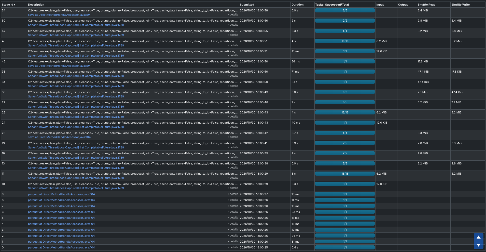
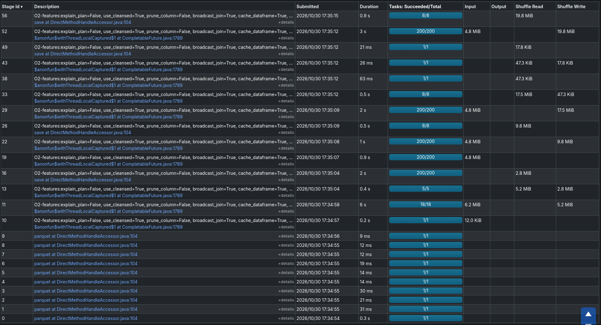
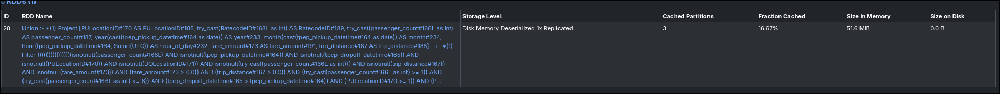
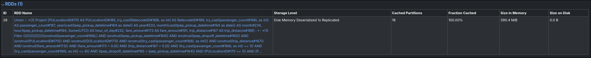

# M2, O2, O4: persist results reused by several actions

- Date: 2026-10-30
- Data: 2026-01..08 (29.7 M records, 20.95 M after cleaning), local machine (see [baseline](../../baseline/README.md#experimental-setup))
- Before: `--broadcast-join` ([broadcast-join](../broadcast-join/README.md), commit `004d3e4`)
- After: `--broadcast-join --cache-dataframe`, commit `78638d7`

## Bottleneck observed

After the broadcast join, the shuffles and spills are gone and the scans dominate. The ops that run several actions scan and clean the trips once per action ([stages_M2](../broadcast-join/logs/stages_M2.txt), [stages_O2](../broadcast-join/logs/stages_O2.txt), [stages_O4](../broadcast-join/logs/stages_O4.txt)):

| Op | Scan stages (18 tasks each) | Scan task time | Cause |
| -- | --------------------------- | -------------- | ----- |
| M2 | 11, 15 | 80.4 s + 60.2 s | `emit()` and the parquet write are 2 actions on the same result |
| O2 | 11, 25, 45 | 54.7 s + 25.2 s + 21.6 s | the 3 outputs (route shares, top 20, reversals) all recompute `routes` |
| O4 | 10, 13 | 56.7 s + 62.5 s | the bucket aggregation and the join back both scan and clean the trips |

## Hypothesis

Spark does not reuse results between actions unless told to. If the DataFrame that several actions share is persisted, only the first action scans the trips and the others read the cache. Expected savings: about one scan for M2 and O4, and two for O2.

## Change

`--cache-dataframe` (`proj1/src/proj1/__init__.py`) persists the shared DataFrame (default `MEMORY_AND_DISK`) and unpersists it at the end of the op:

- M2: `dated_df.cache()`, the 967-row aggregate, before `emit` and the write.
- O2: `routes.cache()`, the monthly route aggregate with zone names, before the 3 outputs. This replaces the old cache of the 265-row zone table, which saved nothing.
- O4: the cleaned trips with `hour_of_day`/`year`/`month`, before the bucket aggregation. Only the 8 columns that both consumers use are selected before `.cache()`, because a cache stops Spark from pruning columns below it.

```python
if features.cache_dataframe:
    trip_df = trip_df.select(*used_columns).cache()
```

Results are bit-identical with and without the flag: same rows for O2 and O4 (`--sink show`), same M2 parquet content.

## Before / after

Median of 3 runs. Before: [broadcast_1](../broadcast-join/logs/broadcast_1.log), [broadcast_2](../broadcast-join/logs/broadcast_2.log), [broadcast_3](../broadcast-join/logs/broadcast_3.log). After: [cache_1](./logs/cache_1.log), [cache_2](./logs/cache_2.log), [cache_3](./logs/cache_3.log). Jobs, stages, tasks and shuffle bytes were identical in the 3 after runs. Task time is from run 1.

| Op | Wall time (s) before → after | Scan stages | Tasks | Task time total | Shuffle read |
| -- | ---------------------------- | ----------- | ----- | --------------- | ------------ |
| M2 | 20.9 → 23.2 (slower) | 2 → 1 | 76 → 673 | 129.9 → 131.4 s | 1.5 MB → 0.8 MB |
| O2 | 21.7 → 17.0 (1.28×) | 3 → 1 | 393 → 2 547 | 115.3 → 90.9 s | 47.9 MB → 55.3 MB |
| O4 | 15.6 → 19.9 (slower) | 2 → 1 | 113 → 149 | 107.9 → 135.9 s | 1.8 MB → 1.8 MB |
| M3 (control) | 11.8 → 12.0 | 1 → 1 | 58 → 58 | – | 0.7 MB → 0.7 MB |
| M1 (control) | 12.0 → 11.7 | 1 → 1 | 76 → 76 | – | 5.4 KB → 5.4 KB |

No op spills. The formatted plans now read the cache through `InMemoryTableScan` nodes (18 in run 1).

Per stage ([stages_M2](./logs/stages_M2.txt), [stages_O2](./logs/stages_O2.txt), [stages_O4](./logs/stages_O4.txt)), and cache sizes read from the Spark UI storage endpoint during the run:

| Op | Cached | Cache size (memory / disk) | What changed |
| -- | ------ | -------------------------- | ------------ |
| M2 | 967 rows, 200 partitions | 0.2 MiB / 0 | One scan (stage 11, 78.0 s). The parquet write now runs 200 tasks (stage 17, 47.2 s) and writes 663 files instead of 6. |
| O2 | monthly routes, 200 partitions | 4.8 MiB / 0 | One scan (stage 11, 62.5 s). The 3 outputs read the cache in 200-task stages of 3.6-28.6 s. |
| O4 | 20.95 M trips × 8 columns, 18 partitions | 390.4 MiB / 0 | Scan + cache build (stage 10) takes 97.7 s, up from 56.7 s. The two consumers read the cache in 15.8 s and 23.0 s instead of 62.5 s for the second scan. |

O2 before: three 18-task scan stages (11, 25, 45):



O2 after: one 18-task scan (stage 11). The 3 outputs read the 4.8 MiB cache in 200-task stages (16-52):



O4 cache in the Storage tab, while it is built (3 of 18 partitions) and once complete (390.4 MiB in memory, nothing on disk):





## Why only O2 got faster

- **O2 works as expected.** The cache holds a small aggregate (4.8 MiB), so building it is cheap and 2 of the 3 scans disappear (−24 % task time).
- **M2: the cache turns off AQE's partition coalescing.** The cached result keeps the 200 shuffle partitions of the aggregation, where before AQE coalesced them into 1. The write that reads the cache then runs 200 tasks and, partitioned by `Borough`, writes 663 small files. That costs more than the saved scan. The real problem is the double action, and caching a 967-row result is the wrong fix for it. Better options: compute once and write once (e.g. emit from the written parquet), or coalesce before the cache.
- **O4: building the cache costs more than the rescan it saves.** Persisting 21 M rows as deserialised objects (390 MiB) adds 41 s of task time to the scan stage. The second parquet scan it saves cost 62.5 s, but reading the cache twice adds 38.8 s, so the net is +28 s of task time. Parquet with vectorised reads and pushed-down filters is already a fast source. With only 2 consumers, a cache of the full trip table does not pay for itself at this scale.

Conclusion: keep the cache only where the shared result is much smaller than its input and is reused enough (O2). For the optimised configuration, `--cache-dataframe` should stay limited to O2. M2's double action needs a different fix (see the backlog).

## Reproducing

```bash
# before
uv run --package proj1 proj1 all --broadcast-join --sink noop --explain-plan -v > proj1/reports/all/broadcast-join/logs/broadcast_<n>.log 2>&1
# after
uv run --package proj1 proj1 all --broadcast-join --cache-dataframe --sink noop --explain-plan -v > proj1/reports/all/reuse-results/logs/cache_<n>.log 2>&1
uv run python proj1/reports/tools/stages.py <CMD> proj1/reports/all/reuse-results/logs/stages_<CMD>.txt --broadcast-join --cache-dataframe
uv run python proj1/reports/tools/medians.py proj1/reports/all/reuse-results/logs/cache_{1,2,3}.log
```
