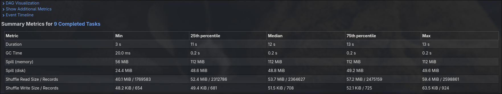
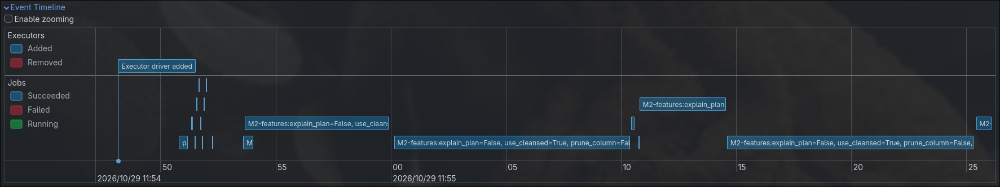
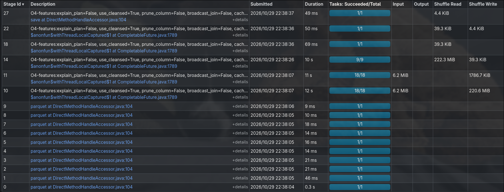
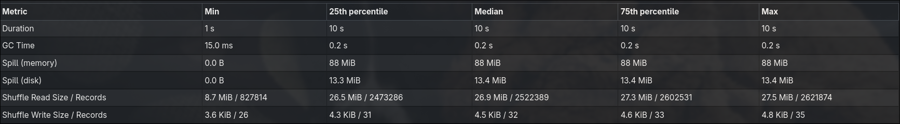

# Baseline

Source for LaTeX section 3 (Profiling and Baseline).

- Date: 2026-10-29
- Commit: `7c81125` (all optimisation flags off)
- Data: 2026-01..08, 29.7 M records (20.95 M after cleaning), ~500 MB parquet

## Experimental setup

| Item | Value |
| ---- | ----- |
| Machine | Laptop, Intel Core i7-1195G7 (4 cores / 8 threads, 2.9 GHz), 15 GiB RAM |
| Spark | 4.2.0 (PySpark), `local[*]` = 8 cores, OpenJDK 25, Python 3.14 |
| Memory | `spark.driver.memory=2g` (in local mode the driver also runs the tasks) |
| Non-default config | `spark.sql.autoBroadcastJoinThreshold=-1`, `spark.sql.session.timeZone=UTC` |
| Defaults that matter | AQE on, `spark.sql.shuffle.partitions=200` (AQE coalesces them) |
| DI cluster | not available; the cluster baseline (wall-clock and per-stage) comes from the Docker standalone cluster, see [docker-session](../docker-session/README.md#baseline-vs-final-3-workers) |

Commands:

```bash
# 3 runs, medians below
uv run --package proj1 proj1 all --sink noop --explain-plan -v > proj1/reports/baseline/logs/all_<n>.log 2>&1
# per-stage metrics and task-time quantiles from the Spark REST API, one separate run per op
uv run python proj1/reports/tools/stages.py <CMD> proj1/reports/baseline/logs/stages_<CMD>.txt
# medians and per-run metrics from the profiler tables
uv run python proj1/reports/tools/medians.py proj1/reports/baseline/logs/all_{1,2,3}.log
```

## Baseline measurements

Median of 3 runs ([all_1](./logs/all_1.log), [all_2](./logs/all_2.log), [all_3](./logs/all_3.log)). Stage, task, shuffle and spill numbers were identical in all 3 runs (spill varies by < 5 %).

| Op | Wall time (s), median [min-max] | Jobs | Stages | Tasks | Shuffle read / write | Spill memory / disk |
| -- | ------------------------------- | ---- | ------ | ----- | -------------------- | ------------------- |
| M1 | 14.5 [12.7-17.4] | 4  | 8  | 76  | 5.4 KB / 2.9 KB   | 0 / 0 |
| M2 | 45.7 [42.8-57.7] | 8  | 18 | 152 | 953.8 MB / 953.8 MB | 1.9 GB / 832.6 MB |
| M3 | 21.1 [20.3-25.6] | 4  | 9  | 76  | 318.5 MB / 318.5 MB | 768.0 MB / 261.3 MB |
| O2 | 20.3 [19.0-24.9] | 22 | 81 | 515 | 53.9 MB / 48.0 MB   | 0 / 0 |
| O4 | 22.1 [20.6-22.3] | 6  | 18 | 220 | 222.4 MB / 222.4 MB | 704.0 MB / 106.8 MB |

Run 1 was the slowest for every op (first run after a cold start, JVM warm-up and OS file cache). Runs 2 and 3 are within ~15 % of each other.

Input size is not taken from Spark. The profiler and the Spark UI agree (e.g. 6.2 MiB of input for M3), but the parquet column chunks M3 reads (7 of 20 columns, 8 files) add up to 383.2 MiB of the 487.6 MiB total, according to the parquet footers (`pyarrow` `total_compressed_size`). Spark's input metric undercounts this scan, so input volume is reported from the footers instead.

## Bottlenecks found

### Where the time goes: the trip-side shuffle of the zone join

Plan shape (formatted plans in the logs):

| Op | `SortMergeJoin` | `Exchange` | `Window` | Trip-table scans (`Union` branches) |
| -- | --------------- | ---------- | -------- | ----------------------------------- |
| M2 | 1 | 3 | 0 | 1 |
| M3 | 1 | 3 | 4 | 1 |
| O2 | 2 per output × 3 outputs | 18 | 3 | 3 |
| O4 | 1 | 4 | 0 | 2 |

Every operation joins ~21 M cleaned trips with the 265-row zone table (O4 joins the trips with the ≤ 6 312-row bucket table (263 zones × 24 hours)) as a **sort-merge join**. The whole trip side is hashed by the join key, written to shuffle files, read back and sorted. The plan is annotated in [pipeline](../pipeline/README.md#physical-plan-m2).


Per-stage numbers ([stages_M2](./logs/stages_M2.txt), [stages_M3](./logs/stages_M3.txt), [stages_O4](./logs/stages_O4.txt)):

| Op | Stage (role) | Tasks | Task time total | Shuffle | Spill memory / disk | Task time p50 / max |
| -- | ------------ | ----- | --------------- | ------- | ------------------- | ------------------- |
| M2 | 11 (scan + clean + shuffle write) | 18 | 59.7 s | write 476.4 MB | 0 | 3.3 s / 6.2 s |
| M2 | 14 (shuffle read + sort + SMJ + partial agg) | 9 | 99.1 s | read 476.4 MB | 896 MB / 392 MB | 12.0 s / 12.9 s |
| M3 | 11 (scan + shuffle write) | 18 | 52.5 s | write 318.4 MB | 0 | 2.8 s / 5.3 s |
| M3 | 14 (SMJ + aggregate) | 9 | 101.1 s | read 318.4 MB | 768 MB / 261 MB | 12.4 s / 12.9 s |
| O4 | 10 (scan + shuffle write, join side) | 18 | 88.5 s | write 220.6 MB | 0 | 4.9 s / 9.7 s |
| O4 | 14 (SMJ join back + aggregate) | 9 | 73.7 s | read 222.3 MB | 704 MB / 107 MB | 9.2 s / 9.3 s |

Observations:

1. **All spill happens in the stage after the trip-side shuffle.** The sort of the SMJ does not fit in execution memory (2 GB driver/executor JVM shared by 8 tasks).
2. **AQE coalesces the 200 shuffle partitions down to 9.** Each task then sorts ~53 MB (M2) of shuffle data, so it spills. With 8 cores, 9 tasks run in 2 waves: the 9th task runs alone for ~12 s while 7 cores idle.


3. The scan stages show a 2× max/median task time. That comes from uneven file splits (min task time 19-48 ms means near-empty splits), not from key skew.

### M2 is computed twice

M2 has 18 stages vs 9 for M3. Stages 11 and 14 run again as stages 20 and 23 (same 476.4 MB shuffle, same spill), because `emit()` (noop sink) and the parquet write are two separate actions on the same DataFrame. Half of M2's shuffle (953.8 MB = 2 × 476.4 MB) and spill is this recomputation. The Spark UI shows two SQL queries with the same plan ([query 0](./images/query0M2.svg), [query 1](./images/query1M2.svg)) and the long jobs repeat on the timeline:



### O2 recomputes the route aggregation for each output

O2 prints 3 results (route shares, top-20, Q1/Q3 reversals). Each is a separate action, so the scan + clean + monthly route aggregation runs 3 times (stages 11, 42, 74: 57.5 s + 23.3 s + 20.3 s task time). The rest of O2 is cheap: no spill, every shuffle ≤ 6.5 MB, 81 small stages. Shuffling zone-name strings costs little at this data size, because O2 aggregates to ≤ 263 × 263 × months rows before the names are joined.

### O4 scans the trip table twice

The bucket fractions and the join back each read and clean the trip table again (2 `Union` branches in the plan, see the [O4 SQL DAG](./images/query0O4.svg)). The bucket side is cheap (stage 11: 1.7 MB shuffle after partial aggregation). The join side shuffles every trip row (stage 10: 220.6 MB) to join with ≤ 6 312 bucket rows. Stages 10 and 11 are the two scans; they run in parallel, both reading the same files:



### Skew: not found on this data

In the reduce stages the max task time is at most 1.1× the median (M2 12.0 s vs 12.9 s, M3 12.4 s vs 12.9 s, O4 9.2 s vs 9.3 s). Hot zones (JFK, Midtown) do not stall a stage, because AQE packs many keys into each of the 9 partitions. Re-check at full scale (2016-2020) and on the cluster, where partitions are smaller.



The single short task (min 1 s, 8.7 MiB read) in each reduce stage is the 9th partition AQE left over.

## Mapping to the backlog

| Finding | Backlog row | Status |
| ------- | ----------- | ------ |
| SMJ on a tiny table shuffles all trips (M2, M3, O2) | SortMergeJoin against the zone table | confirmed |
| O4 join back shuffles all trips | O4 join back | confirmed |
| Spill + 2 waves after AQE coalescing to 9 partitions | Shuffle partitions / AQE coalescing | confirmed |
| M2 runs twice | M2 result computed twice | confirmed |
| O2 recomputes routes 3×, O4 scans twice | Cleaned trips recomputed | confirmed (inside single ops too) |
| String keys in O2 shuffles | O2 string keys | weak: O2 shuffles ≤ 6.5 MB per stage |
| Hot-zone skew | Skew on hot pickup zones | not confirmed at this scale |

## Screenshots

Taken with `--keep-ui` from <http://localhost:4040>, embedded above. Job counts differ between the profiler and the UI: the profiler counts only the jobs of the operation (O2: 22), while the UI also lists the ~10 parquet footer/schema jobs of `load_trips` (O2: 32 in total, stages 0-9 in the O4 screenshot).
