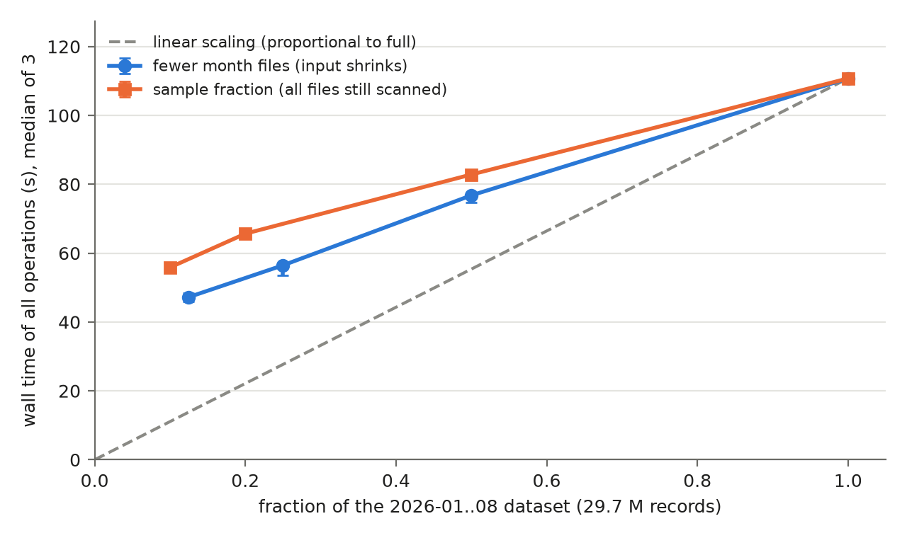

# Docker cluster session: baseline, dataset scale and cluster size

- Date: 2026-11-05 23:45 to 2026-11-06 02:05, one session
- Data: 2026-01..08 (29.7 M records)
- Cluster: Docker standalone on the laptop (i7-1195G7, 4 cores / 8 threads, AC power, `performance` profile): 1 master, 1-3 workers of 2 cores / 2 GiB (`spark.executor.memory=1536m`), driver in the `jupyter` container, repo mounted at `/repo` in every container
- Final configuration: `--broadcast-join --cache-dataframe --write-once --materialise-clean --coalesce-cache`
- Runs: `all`, `--sink noop`, 3 per point; each run started after a 20 s pause once the 1-minute load average was below 1.0
- Time of a run = sum of the profiled blocks (`clean` write + M1, M2, M3, O1, O2, O4)

Why: the assignment makes cluster results mandatory for the baseline wall-clock / per-stage numbers and for both scalability analyses. The DI cluster was not available, so every cluster number in the report comes from this session. It replaces the earlier Docker series ([docker](../docker/README.md), 2026-11-02, and the cluster-size table in [scalability](../scalability/README.md), 2026-11-01), which ran on different days and disagreed by up to 1.7× in absolute time: the 2026-11-01 series measured 74.0 s for the same 3-worker run that took 113.5 s on 2026-11-02 and 110.7 s here. In this session two independent sets of 3-worker runs (blocks 1 and 3 below) agree within 0.5 s (110.7 vs 110.2 s).

Order: (1) 3 workers, 3 rounds of baseline, final, samples 0.1/0.2/0.5 and months 1/2/4, interleaved; (2) stage dumps of baseline and final; (3) cluster size, 3 rounds of 1, 2, 3 workers, interleaved.

## Baseline vs final (3 workers)

Logs: `w3_baseline_<n>.log`, `w3_opt_<n>.log`.

| Op | Baseline (s) | Final (s) | Speedup |
| --- | --- | --- | --- |
| M2 | 44.0 | 13.8 | 3.2× |
| M3 | 19.1 | 10.4 | 1.8× |
| O2 | 26.1 | 16.2 | 1.6× |
| O4 | 27.8 | 10.0 | 2.8× |
| clean (one-time write) | – | 18.0 | |
| all blocks | 163.9 [160.8-164.3] | 110.7 [109.6-111.5] | 1.5× |

Locally (`local[*]`, [cumulative](../cumulative/logs/) step 1 → 5) the same path goes 136.8 → 76.9 s (1.8×).

### Per-stage duration

Longest stages in one run of each configuration ([stages_baseline](./logs/stages_baseline.txt), [stages_optimised](./logs/stages_optimised.txt); wall = submission to completion, task time = summed task run time):

| Config | Stage (role) | Tasks | Wall (s) | Task time (s) | Shuffle | Spill mem / disk |
| --- | --- | --- | --- | --- | --- | --- |
| baseline | 49, O1 window (outside the report scope) | 7 | 23.3 | 130.9 | read 363.1 MB | 2 704 MB / 413 MB |
| baseline | 22, M2 SMJ reduce | 9 | 14.6 | 75.0 | read 476.3 MB | 0 |
| baseline | 155, O4 SMJ reduce | 7 | 11.2 | 64.3 | read 221.7 MB | 1 056 MB / 161 MB |
| final | 36, O1 window | 7 | 18.6 | 107.0 | read 227.8 MB | 1 344 MB / 167 MB |
| final | 10, scan + clean + write of the cleaned copy | 12 | 16.6 | 87.5 | – | 0 |
| final | 12, first scan of the cleaned copy | 12 | 10.4 | 55.9 | – | 0 |

The bottlenecks match the local profile: in the baseline, the sort-merge-join reduce stages (M2's does not spill here, because its 9 tasks are spread over three 1.5 GiB executors; O4's still spills 1.0 GB); after the optimisations, the one-time write of the cleaned copy and plain scans, with no trip-side shuffle left in the reported operations.

## Dataset scale (3 workers, final configuration)

Logs: `w3_m<k>_<n>.log` (first k month files, `--data-dir /repo/out/docker/months/data_m<k>` built with [month_dirs.py](../tools/month_dirs.py) inside the container), `w3_s<f>_<n>.log` (`--sample-fraction f`), `w3_opt_<n>.log` (full data).

| Series | Fraction | Median (s) [min-max] | `clean` write (s) | Time / full |
| --- | --- | --- | --- | --- |
| months | 0.125 (1 file) | 47.2 [46.0-48.4] | 7.4 | 0.43 |
| months | 0.25 (2 files) | 56.5 [53.5-57.1] | 9.4 | 0.51 |
| months | 0.5 (4 files) | 76.8 [74.7-77.1] | 11.5 | 0.69 |
| sample | 0.1 | 55.9 [55.0-56.5] | 10.7 | 0.50 |
| sample | 0.2 | 65.6 [65.2-66.0] | 11.4 | 0.59 |
| sample | 0.5 | 82.8 [82.6-83.2] | 14.3 | 0.75 |
| both | 1.0 (8 files) | 110.7 [109.6-111.5] | 18.0 | 1.00 |

- **Sub-linear, as locally.** 8× the input costs 2.3× the time (47.2 → 110.7 s). A least-squares line through the month series gives T ≈ 39 s + 73 s·f (locally 25 s + 66 s·f): the fixed part is larger on the cluster (more executor JVMs to schedule on, per-executor warm-up, shuffles between containers), the per-record slope similar.
- **Sampling still overstates small inputs.** The 10 % sample (55.9 s) is slower than the 12.5 % month input (47.2 s): `sample()` filters after the scan, so every file is still read.

## Cluster size (final configuration, full data)

Logs: `size_w<workers>_<n>.log`.

| Workers | Executor cores | Median (s) [min-max] | Speedup vs 1 worker | Efficiency |
| --- | --- | --- | --- | --- |
| 1 | 2 | 85.7 [84.2-86.7] | 1.00 | 1.00 |
| 2 | 4 | 92.5 [91.0-93.7] | 0.93 | 0.46 |
| 3 | 6 | 110.2 [108.8-110.8] | 0.78 | 0.26 |

Task time of the same work grows with the number of executors (median of 3):

| Workers | `clean` task time | M3 task time | O2 task time |
| --- | --- | --- | --- |
| 1 | 27 s | 13 s | 16 s |
| 2 | 51 s | 23 s | 42 s |
| 3 | 91 s | 39 s | 50 s |

Every added worker makes the run slower, for the reasons in [scalability](../scalability/README.md#docker-standalone-cluster-on-the-laptop-2026-11-01-supplement): the containers share the same 4 physical cores (6 executor cores + driver + master), the clock drops with more active cores, each executor JVM repeats class loading and JIT compilation in a short run, and the fixed driver-side part caps the speedup (Amdahl). `local[*]` (one JVM, 8 threads) runs the same configuration in 76.9 s, faster than any Docker size.

## Reproducing

[docker_session.zsh](./docker_session.zsh) runs the whole session (cluster scaling, month directories, all runs and stage dumps) and writes `logs/`. Summary tables: `uv run python proj1/reports/tools/medians.py proj1/reports/docker-session/logs/<group>_*.log`; chart: `uv run python proj1/reports/tools/plot_scale.py proj1/reports/docker-session/logs proj1/reports/docker-session/images/scale`.
