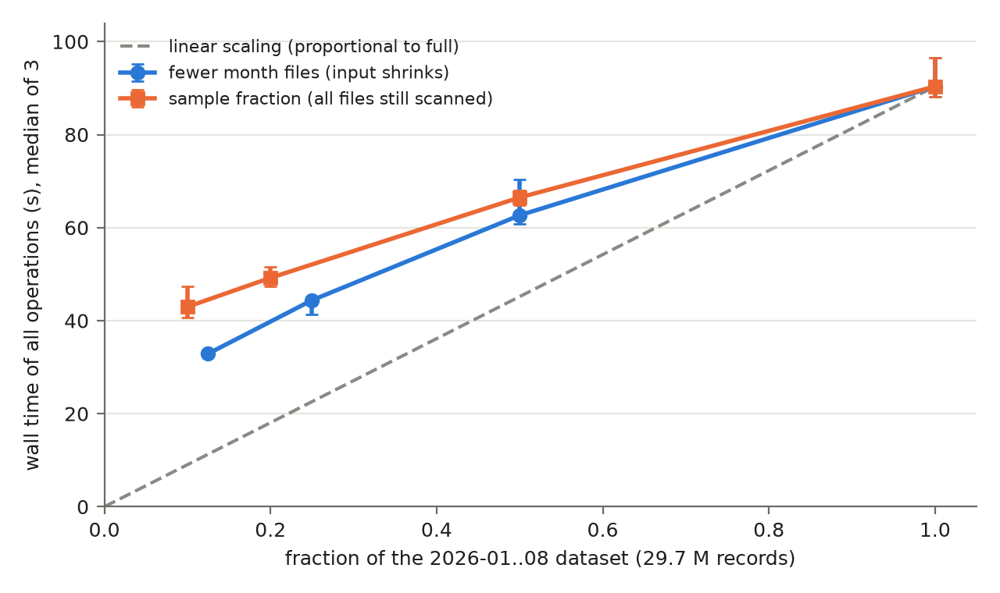

# Scalability

Source for LaTeX section 5 (Analysis). Runs use the **optimised** pipeline, so this is filled in after the optimisation study.

## Dataset scale

Question: does execution time grow sub-linearly, linearly or worse with the data size, and why?

### Local (2026-11-01)

Optimised pipeline: `--broadcast-join --cache-dataframe --write-once --materialise-clean`, `all` with `--sink noop`, 3 runs per point. The machine was idle (load average 0.8 before the runs). Time = the sum of all profiled blocks of one run (the `clean` write plus M1, M2, M3, O1, O2, O4).

Two series, because they separate two different costs:

- **Sample fraction** (`--sample-fraction` 0.1 / 0.2 / 0.5): the spec's method. `sample()` filters rows *after* the scan, so every file is still read and decoded.
- **Month files** (1 / 2 / 4 / 8 months, i.e. 0.125-1.0): the input itself shrinks. These runs point `--data-dir` at directories that symlink the first k month files, with no code change.

```bash
uv run --package proj1 proj1 all --broadcast-join --cache-dataframe --write-once --materialise-clean --sink noop -v --sample-fraction <f> > proj1/reports/scalability/logs/sample_f<f>_<n>.log 2>&1
uv run --package proj1 proj1 all --broadcast-join --cache-dataframe --write-once --materialise-clean --sink noop -v --data-dir <dir with k month files> > proj1/reports/scalability/logs/months_m<k>_<n>.log 2>&1
uv run python proj1/reports/tools/plot_scale.py proj1/reports/scalability/logs proj1/reports/scalability/images/scale
```



PDF version for LaTeX: [images/scale.pdf](./images/scale.pdf).

| Series | Fraction              | Median (s) [min-max] | of which `clean` write (s) | Time / full |
| ------ | --------------------- | -------------------- | -------------------------- | ----------- |
| months | 0.125 (1 file)        | 32.9 [32.5-33.1]     | 5.4                        | 0.36        |
| months | 0.25 (2 files)        | 44.4 [41.3-44.6]     | 7.0                        | 0.49        |
| months | 0.5 (4 files)         | 62.6 [60.8-70.4]     | 10.8                       | 0.69        |
| sample | 0.1                   | 43.0 [40.7-47.4]     | 9.2                        | 0.48        |
| sample | 0.2                   | 49.2 [47.3-51.6]     | 10.6                       | 0.54        |
| sample | 0.5                   | 66.5 [64.9-68.1]     | 13.6                       | 0.74        |
| both   | 1.0 (8 files, 29.7 M) | 90.3 [88.1-96.5]     | 17.9                       | 1.00        |

Per op, 1 month vs 8 months (median wall time, s; logs `months_m1_*`, `months_m8_*`):

| clean      | M1        | M2        | M3        | O1         | O2          | O4        |
| ---------- | --------- | --------- | --------- | ---------- | ----------- | --------- |
| 5.4 → 17.9 | 2.8 → 8.6 | 3.4 → 8.7 | 2.8 → 6.8 | 5.4 → 22.0 | 10.6 → 15.8 | 2.6 → 8.1 |

### Interpretation: sub-linear, because of a fixed cost

- **Sub-linear overall.** With 8× more input (1 → 8 month files), time grows only 2.7× (32.9 → 90.3 s). A straight line through the months series fits T ≈ 25 s + 66 s × fraction: about 25 s of every run is a fixed cost that does not depend on the data size.
- **Where the fixed cost is**:
  - Each of the ~10 Spark actions per run pays for job and stage scheduling and the JVM side of the noop/parquet sinks.
  - O2 in particular: its 3 outputs run in 200-partition stages over the cached routes (2 443 tasks), so O2 takes 10.6 s on 1 month and only 15.8 s on 8. Its time is task scheduling, not data.
  - Planning, file listing and footer reads add a smaller part.
- **Sampling hides less work than it seems.** At 10 % of the rows, the sample run (43.0 s) is slower than the 12.5 % month run (32.9 s). `sample()` drops rows after the scan, so every file is still read and decoded: the `clean` step alone costs 9.2 s at 10 % vs 5.4 s at 12.5 % of real input. A sample-based scale test therefore overstates the time small inputs need.
- **The per-record part is linear.** Between 4 and 8 months, time grows 62.6 → 90.3 s, almost exactly the slope of the fit. The data-dependent work is one scan plus partial aggregates per op, with no shuffle of trip rows left after the optimisations, so nothing grows faster than linearly. At this scale nothing spills, at any size.
- **What to expect at 2016-2020 (~17× the local data).** The fixed ~25 s becomes negligible and the run is dominated by the linear scan term. The two unknowns are the `clean` write, which does not fit in memory (it is a parquet write, so it does not need to), and the 32-row-groups-per-8-files limit on scan parallelism, which the cleaned copy already removes.

### Other environments

The Docker dataset-scale series (3 workers, final configuration) is in [docker-session](../docker-session/README.md#dataset-scale-3-workers-final-configuration): T ≈ 39 s + 73 s·f.

| Environment | Data        | Fraction | Records | Median wall time (s) |
| ----------- | ----------- | -------- | ------- | -------------------- |
| docker (3 workers) | 2026-01..08 | 0.1      | 10 %    | 55.9                 |
| DI cluster  | 2016-2020   | 0.1-0.2  | TODO    | TODO                 |
| DI cluster  | 2016-2020   | 1.0      | TODO    | TODO                 |

## Cluster size (TODO: DI cluster not available yet)

Runs: optimised `all` on 2 nodes, then on the full allocation. Report speedup S = T₂ / Tₙ and efficiency E = S / (n / 2), and explain deviations from linear speedup (shuffle over the network, skewed stages, driver-side work, too few partitions).

| Nodes | Cores | Median wall time (s) | Speedup | Efficiency |
| ----- | ----- | -------------------- | ------- | ---------- |
| 2     | TODO  | TODO                 | 1.0     | 1.0        |
| TODO  | TODO  | TODO                 | TODO    | TODO       |

Record the cluster topology (workers, cores and memory per worker) and the `spark-submit` command in the project README.

### Docker standalone cluster on the laptop (2026-11-01, supplement)

> [!NOTE]
> Superseded by [docker-session](../docker-session/README.md) (2026-11-05): absolute times differed by up to 1.7× between days, so the report takes every cluster number from that single session (1/2/3 workers: 85.7 / 92.5 / 110.2 s). The explanation below still holds; the numbers here are kept for reference.

Topology: the Spark 4.2.0 standalone image (`docker-spark-env`), with 1 master and 1-3 workers of 2 cores / 2 GiB each (`spark.executor.memory=1536m`). The driver runs in the `jupyter` container, and every container mounts the repo at `/repo`. Each worker hosts one executor. All containers share the same laptop: 4 physical cores / 8 threads (i7-1195G7).

Same optimised `all` on the full data (29.7 M records), 3 runs per worker count, interleaved. Each run started only once the 1-minute load average was below 1.5. A first series was discarded because a machine-wide slowdown hit every op equally in 6 of its 9 runs. Logs: `logs/docker_w<workers>_<n>.log`.

```bash
./boot.sh   # or: cd docker-spark-env && docker compose up -d --scale spark-worker=<w>
cd docker-spark-env && docker compose exec -T -w /repo \
  -e PYTHONPATH=/repo/proj1/src:/opt/spark/python:/opt/spark/python/lib/py4j-0.10.9.9-src.zip \
  jupyter python3 -m proj1 all --master docker --data-dir /repo/proj1/data --output-dir /repo/out/docker \
  --broadcast-join --cache-dataframe --write-once --materialise-clean --sink noop -v
```

| Workers | Executor cores | Median wall time (s) [min-max] | Speedup vs 1 worker | Efficiency |
| ------- | -------------- | ------------------------------ | ------------------- | ---------- |
| 1       | 2              | 69.3 [66.0-70.5]               | 1.00                | 1.00       |
| 2       | 4              | 64.2 [62.2-66.0]               | 1.08                | 0.54       |
| 3       | 6              | 74.0 [73.7-74.5]               | 0.94                | 0.31       |

For comparison, `local[*]` (8 threads, one JVM) runs the same pipeline in 90.3 s (see dataset scale above).

**Why adding workers does not help here.** The extra cores are not real extra hardware. The same work costs more CPU as more executors run at once (task and CPU time from the run 2 logs):

| Workers | `clean` task time / CPU time | M3 task time / CPU time | O2 task time / CPU time |
| ------- | ---------------------------- | ----------------------- | ----------------------- |
| 1       | 23 s / 21 s                  | 8 s / 8 s               | 21 s / 20 s             |
| 2       | 38 s / 33 s                  | 14 s / 11 s             | 49 s / 33 s             |
| 3       | 63 s / 45 s                  | 21 s / 16 s             | 86 s / 39 s             |

- **Shared hardware.** 6 executor cores plus the driver and master JVMs compete for 4 physical cores. Beyond 4 busy threads, hyper-threads share execution units, and the CPU lowers its turbo clock with more active cores. So per-task time grows with parallelism: M3 does the same work in 8 s of task time on 1 worker and 21 s on 3.
- **Per-executor fixed costs.** Every executor is a separate JVM that loads classes, JIT-compiles the same code and fetches the broadcast tables. In a ~70 s pipeline of ~10 short jobs, that warm-up is repeated per executor and never amortised. CPU time rising for the same work (M3: 8 s → 16 s) is that overhead.
- **The fixed driver-side part does not shrink.** The ~25 s fixed cost found in the dataset-scale analysis (job scheduling, O2's ~2 300 small tasks) runs on the driver whatever the executor count. By Amdahl's law that alone caps the speedup well below linear.
- **The same effect explains `local[*]`.** One worker with 2 cores (69.3 s) beats `local[*]` with 8 threads (90.3 s): on this laptop, more concurrent tasks slow each task down more than they add throughput.

**What this means for the DI cluster.** On real nodes each executor gets its own cores, memory bandwidth and disk, so the contention terms disappear, and speedup should come much closer to linear for the scan-dominated part. The fixed driver-side part (~25 s locally) and the 2-to-n node comparison remain to be measured there.
